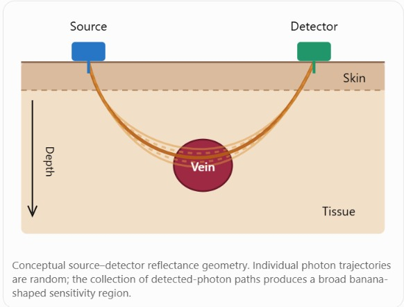
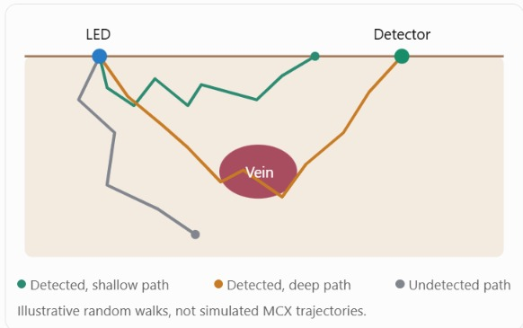
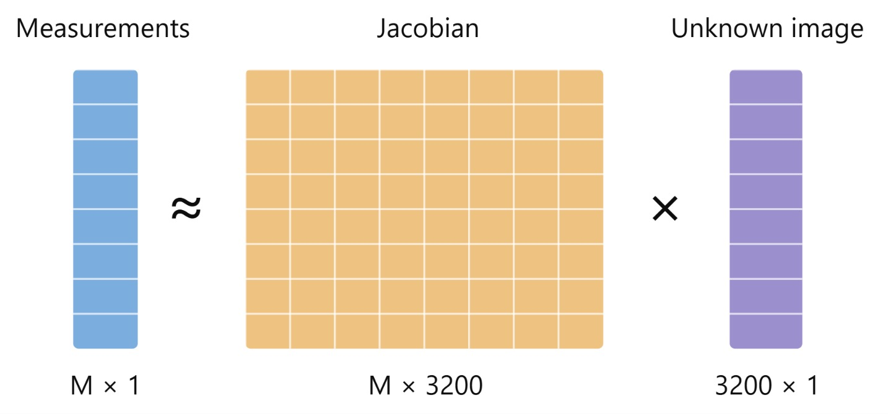

## Understanding the Monte Carlo Vein Reconstruction — Step by Step
Our goal is to reconstruct the location and shape of a vein beneath the skin using near-infrared (NIR) light.

The notebook combines three areas:
1. Light transport physics — how light propagates through scattering and absorbing tissue.
2. Monte Carlo simulation — how we simulate that propagation and calculate what each detector measures.
3. Inverse problems and optimization — how we use those measurements to estimate where the vein is located.
I'll explain the mathematical principles, their physical meaning, and their implementation in the Python code.

You can follow along in your .

## 1. The big picture
Imagine placing an NIR LED and several photodiodes on the surface of a person's skin.

The light enters the tissue, scatters many times, and some of it returns to the surface.

Because blood absorbs NIR light differently from the surrounding tissue, the presence of a vein changes the intensity measured by the photodiodes.





The computational process is:
1. Create the tissue model

2. Simulate light propagation with Monte Carlo

3. Calculate detector intensity changes caused by the vein

4. Construct a sensitivity matrix (Jacobian)

5. Solve the inverse problem

6. Display the reconstructed absorption map


The fundamental idea is that **we don't directly observe the vein. We observe the influence it has on light measurements and work backward to estimate its location.**

## 2. Optical properties of tissue
Before simulating photons, we need to define how light interacts with each tissue.

The four fundamental optical parameters in the code are:
| Parameter | Meaning | Units |
|---|---|---|
|$\mu_a$ | Absorption coefficient | mm⁻¹ |
|$\mu_s$ |	Scattering coefficient |	mm⁻¹ |
|$g$ |	Scattering anisotropy |	Dimensionless |
|$n$ |	Refractive index |	Dimensionless |

#### 2.1 Absorption coefficient — $\mu_a$
Absorption describes the loss of light energy as it travels through a material.

For a homogeneous absorbing medium without scattering, the Beer–Lambert law is:

$$
I(L)=I_0 e^{-\mu_a L}
$$

where $L$ is the traveled distance, and $I_0$ is the initial intensity.

For example, for $\mu_a=0.45\text{ mm}^{-1}$ and $L=2\text{ mm}$:

$$
\frac{I}{I_0}=e^{-0.45\cdot2}\approx0.407
$$

Only about 41% of the original intensity remains along that path due to absorption.

In our simulation, blood is modeled as substantially more absorbing than the surrounding tissue.
#### 2.2 Scattering coefficient — $\mu_s$
Scattering describes how frequently a photon changes its propagation direction.

A simplified random-flight model samples the distance to the next scattering interaction from an exponential distribution:

$$
\ell=-\frac{\ln U}{\mu_s}
$$

where $U$ is uniformly distributed between 0 and 1.

The mean distance between scattering events is:

$$
\mathbb E[\ell]=\frac{1}{\mu_s}
$$

For $\mu_s=12\text{ mm}^{-1}$, the mean scattering length is approximately 0.083 mm.

That means a photon may scatter many times while traveling only a few millimeters into tissue.
#### 2.3 Scattering anisotropy — $g$
Not every scattering event sends the photon in a completely random direction.

Biological tissue tends to scatter light forward.

The anisotropy parameter is:

$$
g=\mathbb E[\cos\theta]
$$

where $\theta$ is the scattering angle.
- $g=0$: Mean cosine is zero, characteristic of isotropic scattering.
- $g\approx1$: Strong forward scattering.
- $g\approx-1$: Strong backward scattering.
A useful quantity is the reduced scattering coefficient:

$$
\boxed{\mu_s'=\mu_s(1-g)}
$$

At 850 nm, our dermis parameters are:

$$
\mu_s'=12(1-0.85)=1.8\text{ mm}^{-1}
$$

This parameter is particularly important when approximating light propagation using the diffusion equation.

#### 2.4 Where is it defined in the code?
```python
'prop_by_wl': {    
    850: np.array([        
        [0,     0,    1,    1],    # Air        
        [.030, 12.0, .85, 1.4],  # Dermis        
        [.015, 8.0,  .85, 1.4],  # Fat        
        [.45,  10.0, .95, 1.38], # Blood    
    ])
}
```


Each row corresponds to a material, and each column to an optical property.

**An important simplification in our actual code:** ```baseline_and_target_properties()``` overrides the scattering and refractive properties of the vein to equal those of fat. It keeps only the increased blood absorption. This is intentional and allows the forward model to use the same photon trajectories when comparing healthy tissue and tissue containing the vein.

The optical values are illustrative simulation parameters, not calibrated measurements from a specific patient.

## 3. Creating the tissue geometry
We represent the tissue as a three-dimensional array of small cubes, called voxels.

The code defines:
```python
'nx': 80,
'ny': 80,
'nz': 40,
'voxel_size_mm': 0.25,
```


Therefore, the physical tissue volume is:

$$
L_x=80(0.25)=20\text{ mm}
$$

$$
L_y=80(0.25)=20\text{ mm}
$$

$$
L_z=40(0.25)=10\text{ mm}
$$

GEOMETRY
| 20mm - Width (X) | 20mm - Length (Y) | 10mm - Depth (Z) |
|---|---|---|


#### 3.1 Tissue layers
The function make_labeled_volume() creates a 3D array assigning each voxel a material label:
v = np.ones((nx, ny, nz), dtype=np.uint8)v[:, :, cfg['subcut_start_vox']:] = 2


Initially, every voxel is labeled 1 (dermis). Starting at voxel 6 in the Z direction, the material changes to 2 (subcutaneous fat).

The boundary is therefore at:

$$
z=6\times0.25=1.5\text{ mm}
$$

#### 3.2 The vein
The vein is a cylinder running along the Y axis.

The equation of its cross-section is:

$$
\boxed{(x-x_v)^2+(z-z_v)^2\le R^2}
$$

In the code:
```python
mask = (    
    (x - cfg['vein_x_mm'])**2 +    
    (z - cfg['vein_z_mm'])**2    
    <= cfg['vein_radius_mm']**2
)
```


We specify:

$$
x_v=11.5\text{ mm},\qquad
z_v=3.0\text{ mm},\qquad R=1.0\text{ mm}
$$

Every voxel inside the cylinder receives material label 3.

Notice: The vein position is used to generate the synthetic measurements, but it is not passed to the inverse solver. The reconstruction algorithm receives only measurements and the Jacobian. This separation is essential for a meaningful reconstruction test.

## 4. Monte Carlo photon propagation
Now that we have the tissue model, we need to determine how light propagates inside it.

In principle, light propagation in tissue can be described by the radiative transfer equation (RTE), which accounts for absorption, scattering, position, and propagation direction.

A simplified steady-state form is:
<!-- cspell:ignore mathbf -->

$$
\hat{\mathbf s}\cdot\nabla L(\mathbf r,\hat{\mathbf s})
+(\mu_a+\mu_s)L(\mathbf r,\hat{\mathbf s})
=
\mu_s\int p(\hat{\mathbf s}',\hat{\mathbf s})
L(\mathbf r,\hat{\mathbf s}')d\Omega'
+Q
$$

Here:
- $L$ is the radiance at position $\mathbf r$ in direction $\hat{\mathbf s}$.
- $p$ is the angular scattering distribution.
- $Q$ represents the illumination source.
Rather than solving this complicated equation directly, Monte Carlo simulates a large number of random photon trajectories.
#### 4.1 What happens to a simulated photon?
A photon packet is launched from the source and repeatedly undergoes scattering, absorption-weight updates, and boundary interactions until it terminates or exits the domain.

Consider three possible trajectories:



The Monte Carlo method repeats this process for thousands or millions of photon packets.

The simulator we use is Monte Carlo eXtreme (MCX), which implements GPU-accelerated photon transport.
#### 4.2 Running the simulation in Python
The relevant function is:
```python
def run_forward(pmcx, base_cfg, cfg, sx_vox, seed):
    ...    
    res = pmcx.run(c)    
    return c, res
```


Some important MCX parameters:
```python
c = {    
    'nphoton': cfg['nphoton'],    
    'vol': base_cfg['volume'],    
    'prop': base_cfg['prop'],    
    'srcpos': [float(sx_vox), float(cfg['y_center_vox']), 0.],    
    'srcdir': [0., 0., 1.],    
    'detpos': cfg['detpos'],    
    'unitinmm': cfg['voxel_size_mm'],    
    'issavedet': 1,    
    'issaveseed': 1,    
    'savedetflag': 'DP',    
    'outputtype': 'flux',
}
```


```nphoton``` controls how many photon packets are launched, while ```vol``` and ```prop``` specify the material layout and optical parameters.

```srcpos``` and ```srcdir``` place the source at the tissue surface, pointing inward. ```detpos``` defines the detectors.

We save two especially important outputs:
- ```detp```: Information about detected photons, including their detector IDs and partial path lengths.
- ```seeds```: Random states that allow MCX to replay the detected photon trajectories.
For the smoke test, the notebook simulates 100,000 photons per source, with three sources and seven detectors.

A crucial distinction: **The Monte Carlo method simulates individual photon paths, but the measurement is the accumulated light intensity reaching each detector.**

## 5. The banana-shaped sensitivity
This is the central physical concept behind reflectance-based optical imaging.
#### 5.1 Why the banana appears
A photon emitted by the source can travel in many directions, but we only care about photons reaching a particular detector.

The probability that a photon reaches a point $\mathbf r$ from the source decreases with distance. The probability that it subsequently reaches the detector also decreases with distance.

In the diffusion approximation, the source–detector absorption sensitivity can be written schematically as:

$$
\boxed{
J(\mathbf r)\propto
G(\mathbf r_s,\mathbf r)
G(\mathbf r,\mathbf r_d)
}
$$

where $G$ is a photon diffusion Green's function, $\mathbf r_s$ is the source position, and $\mathbf r_d$ is the detector position.

This is a product of two propagators: one from the source to the voxel, and one from the voxel to the detector.

The resulting spatial sensitivity commonly forms a banana-shaped region, with strong sensitivity near the optodes and an extended curved region between them. 

[Transformational change in the field of diffuse optics: From going bananas to going nuts](https://pmc.ncbi.nlm.nih.gov/articles/PMC9632641/)
[Diffuse Optics for Tissue Monitoring and Tomography](https://pmc.ncbi.nlm.nih.gov/articles/PMC4482362/)


#### 5.2 Why the original code failed
The earlier implementation calculated:
```python
jac_xz = src_flux_xz * k_det
```


But k_det was a Gaussian artificially centered near the true vein location.

That didn't describe photon sensitivity to absorption at different positions. It created a prescribed spatial preference.

The corrected code obtains sensitivity from the actual MCX detected-photon trajectories.
#### 5.3 Source–detector separation controls depth
The notebook uses:
```python
'sd_min_mm': 4.0,
'sd_max_mm': 11.0,
```


Increasing source–detector separation generally allows deeper tissue to influence the measurement.

However, there's a tradeoff:
| Shorter separation | Longer separation |
|---|---|
| Stronger detected signal | Weaker detected signal |
| Mostly superficial sensitivity | Greater relative sensitivity to deeper tissue |
| Better photon statistics | More photons needed for good statistics |

For a vein centered 3 mm below the surface, the 4–11 mm separation range is a reasonable region to investigate numerically, although the optimal arrangement must be established through simulation and conditioning analysis.

## 6. The forward measurement: how much light reaches each detector?
This is where the code connects Monte Carlo trajectories to the absorption contrast caused by the vein.
#### 6.1 The intensity contribution of a single photon
Suppose one detected photon traveled through three tissue regions.

The partial path lengths are:

$$
L_{p,1},\quad L_{p,2},\quad L_{p,3}
$$

Its final weight, under the absorption model, is:

$$
\boxed{
w_p=\exp\left(
-\sum_{m=1}^{3}\mu_{a,m}L_{p,m}
\right)
}
$$

where $p$ identifies the photon and $m$ identifies the material.

For example, suppose a photon travels:
- 2 mm through dermis;
- 4 mm through fat;
- 1 mm through the vein.
At 850 nm, using the configured absorption coefficients:

$$
w_p=e^{-(0.03\cdot2+0.015\cdot4+0.45\cdot1)}
$$

$$
w_p=e^{-0.57}\approx0.565
$$

The packet retains about 56.5% of its initial weight after the modeled absorption.
#### 6.2 Calculating detector intensity
The detector accumulates the weights of all detected photon packets:

$$
\boxed{
I_d=\sum_{p\in\mathcal D_d}w_p
}
$$

where $\mathcal D_d$ is the collection of photons reaching detector $d$.

This is exactly what happens in detected_photons().

```python
ppath_mm = (np.asarray(d[1:1+nmed].T, dtype=np.float64) * voxel_mm)
w0 = np.exp(-ppath_mm @ baseline_mua)
w1 = np.exp(-ppath_mm @ target_mua)
```


Let's unpack this.

```ppath_mm``` is a matrix with one row per detected photon and one column per material.

The matrix multiplication:
```python
ppath_mm @ baseline_mua
```


calculates:

$$
\sum_m L_{p,m}\mu_{a,m}
$$

for every photon simultaneously.

Then ```np.exp(-...)``` calculates the attenuation.

The multiplication by ```voxel_mm``` is important: MCX's recorded partial path lengths are in voxel units and must be converted to millimeters. 


#### 6.3 Why do we calculate two weights?
We want to compare two scenarios:
| Baseline | With vein |
|---|---|
| **$I_0=\sum_p w_{0,p}$**  The vein compartment has fat-like optical properties. | **$I_1=\sum_p w_{1,p}$** The same region has increased absorption. |

The code uses the same photon trajectories but changes their absorption weights.

This is called perturbation Monte Carlo.

It is particularly useful because rerunning two entirely independent Monte Carlo simulations would introduce additional statistical variation between them.

However, this path reweighting is valid here because the two models have identical scattering and refractive properties. Only absorption changes.
#### 6.4 The actual measured signal
We don't reconstruct from the absolute intensity. Instead, we use the logarithmic intensity ratio:

$$
\boxed{
y_d=\ln\left(\frac{I_{0,d}}{I_{1,d}}\right)
}
$$

In Python:
```python
log_ratio = np.log(I0 / I1)
```


This is a form of differential optical density.

It is useful because multiplicative attenuation becomes additive after taking the logarithm.

For example:

$$
I_0=1000,\qquad I_1=800
$$

Then:

$$
y=\ln(1000/800)\approx0.223
$$

A positive value indicates that adding the vein reduced the detected intensity.

This measurement is a single number associated with a particular source–detector pair.

The inverse problem begins when we ask:

**Which possible distribution of absorption inside the tissue could have produced these intensity changes?**

## 7. The Jacobian: connecting absorption to measurements
This is probably the most important mathematical part of the entire reconstruction.

We know how to simulate measurements if we know the absorption distribution. But now we need to work in the opposite direction.

Suppose we slightly increase absorption at a particular voxel. How much will a particular detector measurement change?

The Jacobian answers exactly that question.
#### 7.1 Mathematical definition
Let the absorption coefficient at voxel $j$ be $\mu_{a,j}$, and the intensity at detector $d$ be $I_d$.

We define positive log-absorption sensitivity as:

$$
\boxed{
S_{dj}=-\frac{\partial\ln I_d}{\partial\mu_{a,j}}
}
$$

The minus sign makes the sensitivity positive: increasing absorption generally decreases intensity.

Each element $S_{dj}$ represents how strongly voxel $j$ influences detector $d$.
#### 7.2 Deriving the Jacobian from photon paths
Recall that the detected intensity is:

$$
I_d=\sum_{p\in\mathcal D_d}w_p
$$

and each photon has weight:

$$
w_p=e^{-\sum_j\mu_{a,j}L_{pj}}
$$

Differentiating with respect to absorption at voxel $j$:

$$
\frac{\partial I_d}{\partial\mu_{a,j}}
=-\sum_{p\in\mathcal D_d}w_pL_{pj}
$$

Therefore:

$$
\boxed{
S_{dj}=
\frac{\sum_{p\in\mathcal D_d}w_pL_{pj}}
{\sum_{p\in\mathcal D_d}w_p}
}
$$

This has a beautiful physical interpretation:

**The sensitivity of a detector to absorption at a voxel is the photon-weighted average path length traveled through that voxel by the photons detected there.**

This is why using photon paths from MCX is so powerful.
#### 7.3 MCX photon replay
The notebook calculates the Jacobian using:
```python
def replay_all_detector_sensitivities(    
    pmcx, forward_cfg, forward_result, cfg
):    
    ...    
    cc.update({        
        'seed': forward_result['seeds'],        
        'detphotons': forward_result['detp'],        
        'outputtype': 'jacobian',        
        'replaydet': -1,        
        'isnormalized': 0,        
        'issave2pt': 1,    
        })    
        
        r = pmcx.run(cc)
```


MCX takes the previously detected photons and replays their trajectories, accumulating weighted path lengths through the voxels.

The setting:
```python
'replaydet': -1
```


asks MCX to calculate separate sensitivities for every detector. The code falls back to replaying detectors individually if the all-detector output is unavailable. This follows the MCX replay approach documented in its official examples. 
[GitHub - Jacobian demo](https://github.com/fangq/mcx/blob/master/mcxlab/examples/demo_replay_all_jacobian.m) 
[Github - mxlab](https://github.com/fangq/mcx/blob/master/mcxlab/mcxlab.m)
#### 7.4 Converting the 3D sensitivity into 2D
The replay output has the shape:
```python
[nx, ny, nz, n_detectors]
```


But our reconstructed unknown is two-dimensional: an X–Z cross-section.

Why?

Because we assumed that the vein extends uniformly along Y.

The sensitivity for the entire vertical column at $(x,z)$ is therefore:

$$
S_d(x,z)=\sum_y S_d(x,y,z)
$$

In the code:
```python
j_xz = (np.sum(jac_all[:, :, :, j], axis=1) * voxel) / I0
```


Notice that the code sums over Y rather than taking a single Y slice. This is important because photons can travel away from the central plane and still contribute to the measurement.

The last step is:
```python
j_row = (j_xz * delta_mua).reshape(-1)
```


Here:

$$
\Delta\mu_a=\mu_{a,\mathrm{blood}}-\mu_{a,\mathrm{fat}}
$$

At 850 nm:

$$
\Delta\mu_a=0.45-0.015=0.435\text{ mm}^{-1}
$$

Multiplying the sensitivity by this contrast allows the unknown to represent a dimensionless vein-fraction map rather than an arbitrary absorption coefficient.

## 8. From the Jacobian to the inverse problem
We now have two things:
- A set of simulated measurements, $y$.
- A Jacobian matrix describing the influence of every possible vein voxel on each measurement.
We want to reconstruct the unknown distribution $f$.

For a sufficiently small absorption perturbation, the first-order approximation is:

$$
\boxed{\mathbf y\approx\mathbf J\mathbf f}
$$

This is the basic inverse problem.
8.1 Understanding the matrix dimensions
Our reconstruction grid is:

$$
80\times40=3200\text{ pixels}
$$

Every pixel is a possible location of increased absorption.

Suppose we have $M$ valid source–detector pairs.

Then:

$$
\underbrace{\mathbf{y}}_{M\times1}=\underbrace{\mathbf{J}\mathbf{f}}_{M\times3200}\underbrace{\mathbf{f}}_{3200\times1}
$$


Each row of $J$ is the sensitivity map for a different source–detector pair, flattened into a vector.

Each column describes how one pixel affects the different measurements.



#### 8.2 A simple numerical example
Before dealing with 3,200 unknowns, imagine there are only two possible absorbing pixels.

The Jacobian is:

$$
J=
\begin{bmatrix}
0.8&0.1\\
0.2&0.7
\end{bmatrix}
$$

Suppose the true vein occupies the first pixel:

$$
f=
\begin{bmatrix}
1\\0
\end{bmatrix}
$$

Our detector measurements become:

$$
y=Jf=
\begin{bmatrix}
0.8\\0.2
\end{bmatrix}
$$

The first detector is more sensitive to the first pixel, and its measurement changes much more.

By solving the inverse problem, we can recover $f$.

The same principle applies to thousands of pixels and many detectors.
#### 8.3 Why can't we simply invert the matrix?
In the real example, there are 3,200 unknown pixels, but far fewer measurements.

The system is therefore underdetermined.

Even worse, neighboring voxels often have very similar sensitivity patterns, making the inverse problem ill-conditioned.

That means many different absorption distributions can explain nearly the same measurements.

Small measurement errors could produce large differences in the reconstructed image.

This is where regularization becomes essential.

## 9. Regularization and the optimization algorithm
The notebook's inverse solver is:
```python
def solve_inverse(J, y, cfg, max_iter=None):    
    ...
```


We want to find a reconstruction that both matches the measurements and has physically reasonable properties.
#### 9.1 Ordinary least squares
The simplest objective would be:

$$
\min_f\frac12\|Jf-y\|_2^2
$$

This minimizes the squared error between the predicted and observed measurements.

But because the system is ill-conditioned, minimizing this term alone may yield an unstable reconstruction.
#### 9.2 Adding regularization
Our code includes three regularization terms.

The first is ridge regularization:

$$
R_{\mathrm{ridge}}(u)=\frac{\lambda_r}{2}\|u\|_2^2
$$

This penalizes large reconstruction values and helps stabilize the inverse solution.

The second is spatial smoothness:

$$
R_{\mathrm{smooth}}(u)=\frac{\lambda_s}{2}\|\nabla u\|_2^2
$$

This penalizes abrupt changes between adjacent pixels. It's useful because neighboring pixels within a vein should generally have related absorption values.

The third is sparsity:

$$
R_{\mathrm{sparse}}(u)=\lambda_1\|u\|_1
$$

This encourages many pixels to remain zero, favoring a localized absorbing structure rather than absorption distributed everywhere.

In the implementation, $f=Cu$, where $C$ is a diagonal, sensitivity-based compensation matrix. With $A=JC/s$ and $b=y/s$ for a numerical scale factor $s$, the optimization problem becomes:

$$
\boxed{
\begin{aligned}
\min_u\quad&
\frac12\|Au-b\|_2^2
+\frac{\lambda_r}{2}\|u\|_2^2\\
&+\frac{\lambda_s}{2}\|\nabla u\|_2^2
+\lambda_1\|u\|_1\\
\text{subject to}\quad&
0\le Cu\le1
\end{aligned}
}
$$

The settings in the notebook are:

```python
'inverse': {    
    'smooth_strength': 0.025,    
    'ridge_strength': 0.003,    
    'sparsity_strength': 0.007,    
    'max_iter': 850,    
    'depth_compensation': 0.35,    
    'max_compensation': 10.0,    'max_absorption_fraction': 1.0,
}
```


These values are numerical tuning parameters, not universal physical constants.
#### 9.3 Depth compensation
One difficulty in diffuse optical tomography is that sensitivity tends to be much stronger near sources and detectors than deeper inside the tissue.

Consequently, a naive reconstruction can place absorbing objects too close to the surface.

The code estimates sensitivity at each pixel:

```python
sens = np.sqrt(np.sum(J**2, axis=0))
```


Mathematically:

$$
s_j=\sqrt{\sum_dJ_{dj}^2}
$$

Pixels with low sensitivity receive a bounded compensation factor.

```python
compensation = (reference / sens_clip) ** inv['depth_compensation']
```


This is a heuristic preconditioning strategy, rather than a fundamental physical law. It attempts to reduce superficial bias without assuming the true vein depth.

Importantly, pixels with extremely low sensitivity are suppressed because the data cannot reliably constrain them.
#### 9.4 The numerical optimization: FISTA
We solve the inverse problem using a form of **Fast Iterative Shrinkage-Thresholding Algorithm (FISTA).**

At each iteration, we compute the gradient of the smooth part of the objective:
```python
grad = (    
    A.T @ (A @ mom - b)    
    + ridge * mom    
    + smooth * spatial_laplacian(mom, nx, nz)
)
```


The corresponding mathematical expression is:

$$
\nabla F(u)=
A^T(Au-b)+\lambda_r u+\lambda_sD^TDu
$$

where $D$ is the discrete spatial-gradient operator.

The code then performs a gradient step with sparsity thresholding and positivity constraints:
```python
next_u = np.maximum(    
    0.0,    
    mom - step * grad - step * l1
)
```


Conceptually, this does three things:
1. Moves toward a reconstruction that better explains the measurements.
2. Suppresses small coefficients to encourage sparsity.
3. Prevents negative vein fractions.
It also enforces the maximum fraction using:
```python
cap = inv['max_absorption_fraction'] / np.maximum(compensation, 1e-12)    
next_u = np.minimum(next_u, cap)
```


Finally, FISTA extrapolates from previous iterations to accelerate convergence.

After optimization, the result is converted back into the absorption-fraction map:
```python
f = (u * compensation).reshape(nx, nz).T
```


The reconstruction contains values approximately between zero and one.

A value close to one indicates that the solver estimates the full configured blood-versus-fat absorption contrast at that location. A value close to zero indicates no estimated additional absorption.

These values should not be interpreted as verified physiological blood volume fractions.

## 10. Why multiple wavelengths?
The code simulates three wavelengths:

| 730nm | 850nm | 940nm |
|---|---|---|


Tissue and blood absorption differ with wavelength, and scattering also varies with wavelength.

This changes both the measured vein contrast and the sensitivity kernels.

For each wavelength $\lambda$, we calculate:

$$
y_\lambda\approx J_\lambda f
$$

The code first solves each wavelength separately:
```python
for r in results:
    recon.append(        
        solve_inverse(r['J'], r['y'], cfg)    
        )
```


Then it performs a joint reconstruction:
```python
J = np.vstack([r['J'] for r in results])
y = np.concatenate([r['y'] for r in results])

fused = solve_inverse(J, y, cfg)
```


Mathematically, stacking the measurements gives:

$$
\begin{bmatrix}
y_{730}\\
y_{850}\\
y_{940}
\end{bmatrix}
\approx
\begin{bmatrix}
J_{730}\\
J_{850}\\
J_{940}
\end{bmatrix}f
$$

We are assuming that the vein geometry $f$ is identical at all wavelengths, while the wavelength-dependent optical coefficients are known.

That gives the inverse solver more measurements of the same unknown structure.

The joint inversion is different from simply averaging three reconstructed images: it estimates a single image that best explains all the spectral measurements simultaneously.

## 11. Understanding the notebook's output figures
The function responsible for the figures is:
display_figures(    cfg, results, recon, fused, output_dir)


Here are the main outputs and what you should look for.


**A. Tissue geometry (ground truth)**

Shows the skin layers, the cylindrical vein, and the source/detector positions. This is your simulation's known reference, not the reconstruction.


**B. MCX sensitivity map**

Should reveal a broad region connecting a source and detector. Its exact shape depends on scattering, absorption, geometry, and photon statistics. The notebook uses a logarithmic color scale to show weaker sensitivity.


**C. Reconstructed absorption maps**

Ideally show a localized region around the vein's simulated position. Don't expect a perfect sharp circle: optical tomography has limited spatial resolution and the inverse problem is heavily regularized.


The notebook also plots the log-intensity contrast against source–detector distance. This is an important diagnostic: it helps reveal whether the simulated measurements contain a detectable absorption effect.

One visualization detail: the reconstruction plots use individually adjusted color limits. As a result, two equally bright-looking maps do not necessarily have equal recovered absorption magnitudes.

## 12. Self-test versus real MCX mode
There are two execution modes.
```python
RUN_MODE = 'self_test'
```


The self_test function generates an approximate sensitivity model using:
```python
rs = np.sqrt((X-sx)**2 + (Z+.35)**2)
rd = np.sqrt((X-dx)**2 + (Z+.35)**2)

k = np.exp(-.58*(rs+rd)) / (rs*rd + 1e-5)
```


This resembles a product of attenuated diffusion propagators.

The synthetic measurements are:
```python
y = J @ gt.reshape(-1)
y += rng.normal(    
    scale=np.max(y)*0.005,    
    size=y.shape)
```


So we create measurements from a known ground truth, add a small amount of noise, and test whether the inverse solver can recover it.

This tests the numerical algebra, not the full photon transport physics.

For actual MCX transport, use:
```python
RUN_MODE = 'mcx'
```


For the first experiment, I would keep:
```python
RUN_STAGE = 'smoke'
```


Only increase the number of sources and photons after verifying that detector counts and sensitivity maps look plausible.

## 13. What are the important limitations of our current model?
There are four important ones.

**First, the inversion is linearized.** The approximation $y\approx Jf$ is a first-order model. The forward measurements use exponential attenuation, which is nonlinear. For stronger absorption perturbations, the first-order relationship becomes less accurate, potentially biasing the reconstructed contrast and location.

**Second, scattering is assumed known and unchanged.** Real veins differ from fat in scattering and refractive properties, not just absorption. Our simplified forward model removes those differences to isolate absorption. A more realistic model would need to account for them.

**Third, we reconstruct a 2D cross-section from a 3D** simulation. This works as a simplified model because the vein is assumed to run uniformly along Y. Recovering arbitrary 3D vessel geometry would require more measurements and a larger inverse problem.

**Fourth, the inverse problem is highly underdetermined.** Even in full mode, there are many fewer independent source–detector measurements than the 3,200 reconstructed pixels. Smoothness, sparsity, and sensitivity compensation can create a plausible localized structure, but they do not guarantee the true location or diameter.

I also want to emphasize that the corrected notebook's inversion was tested synthetically, but **its full MCX replay behavior and actual vein localization have not yet been validated on your GPU.**

## 14. The five experiments I recommend doing to learn the system
Hands-on learning checklist

0/5 completed

- [ ] **1. Understand the banana**  
	Keep one wavelength and select a representative source–detector pair. Inspect the sensitivity map while changing its separation. Compare how sensitivity at 3 mm depth changes.

- [ ] **2. Increase photon statistics**  
	Run smoke, then medium. Compare detector counts and whether the sensitivity patterns become smoother. Check if the reconstructed peak stabilizes.

- [ ] **3. Change vein depth**  
	Test vein_z_mm at 2, 3, and 4 mm. Compare reconstruction peak depth, contrast, and data-fit error. This is a test of depth localization, not just visualization.

- [ ] **4. Remove regularization terms one at a time**  
	Set sparsity_strength to zero, restore it, and then reduce smooth_strength. Observe the effects on noisy pixels, localization, and image compactness.

- [ ] **5. Compare wavelengths**  
	Run the full configuration and compare individual-wavelength reconstructions with the joint inversion. Look for consistent positions rather than judging only image brightness.

## The key equations to remember
| Concept | Equation |
|---|---|
| Absorption along a photon path | $w=e^{-\sum_m\mu_{a,m}L_m}$ |
| Detector intensity | $I_d=\sum_{p\in\mathcal{D}_d}w_p$ |
| Measured contrast | $y_d=\ln(I_{0,d}/I_{1,d})$ |
| Absorption sensitivity | $S_{dj}=-\partial\ln I_d/\partial\mu_{a,j}$ |
| Linearized inverse model | $\mathbf y\approx\mathbf J\mathbf f$ |
| Basic reconstruction objective | $\min_f\|Jf-y\|_2^2+\text{regularization}$ |

The most important distinction is between **forward simulation** and **inverse reconstruction**.

In the forward simulation, we know where the vein is and calculate what the detectors would measure.

In the inverse reconstruction, we know the detector measurements and attempt to recover the vein's location.

The Jacobian is the mathematical bridge between those two problems. Once you understand how it is calculated from photon trajectories, the rest of the inversion algorithm becomes much easier to follow.
